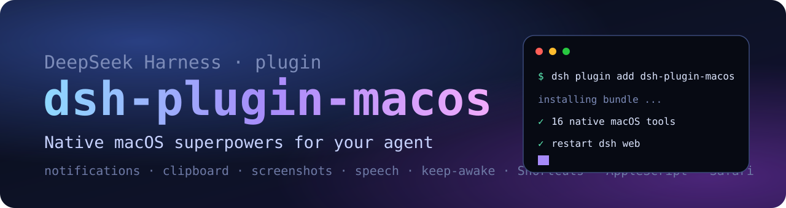

<p align="center">
  
</p>

<h1 align="center">dsh-plugin-macos</h1>

<p align="center">
  <b>Native macOS superpowers for your DeepSeek Harness agent.</b><br>
  21 local tools for notifications, clipboard, screenshots, speech, keep-awake, dark mode,
  Spotlight, Shortcuts, AppleScript and Safari control.
</p>

<p align="center">
  <a href="LICENSE"></a>
  
  
  
</p>

<p align="center">English | <a href="README.zh.md">中文</a></p>

---

**Your agent can write code. This gives it hands on your Mac.**

DeepSeek Harness (dsh) agents can already run bash, but every native macOS action still means
hand-writing AppleScript. ``dsh-plugin-macos`` packages the 21 chores you keep asking an agent to do into
typed, model-facing tools — notifications, clipboard, screenshots, speech, keep-awake, appearance,
Spotlight, Shortcuts, AppleScript and real Safari tabs. Everything runs locally through
``child_process`` and ``osascript``: no cloud service, no browser extension, no accessibility tree, no build step,
no npm dependencies.

## Why this plugin

- **Broad but boring, on purpose.** It covers the long tail of daily Mac chores instead of one narrow trick.
- **Safe by construction.** Every command uses argv arrays — never a shell string — so page text, file names
  and model output cannot inject shell syntax. Destructive verbs are not exposed.
- **Zero-dependency, plain ESM.** ``git clone``, add the bundle, restart. No compile, no install scripts.
- **Bilingual.** English and Chinese docs, plugin metadata and tool descriptions.
- **Honest about permissions.** Reads and writes are split into separate tools, and every macOS permission
  prompt is documented below.

## Tools (21)

### System

| Tool | What it does | Notes |
|---|---|---|
| ``macos_info`` | macOS version, chip, hostname, uptime, battery source, disk, memory | read-only |
| ``macos_network`` | hostname, primary interface, IPv4, current Wi-Fi SSID | read-only |
| ``macos_processes`` | top processes by CPU or memory | read-only |
| ``macos_spotlight`` | search files with Spotlight (``mdfind``) | read-only |
| ``macos_finder_path`` | POSIX path of the front Finder window | read-only |
| ``macos_frontmost_app`` | name of the frontmost application | read-only |
| ``macos_screenshot`` | capture the screen (or a region) to a PNG, return its path | Screen Recording |

### Everyday actions

| Tool | What it does | Notes |
|---|---|---|
| ``macos_notify`` | native notification banner with optional sound | Automation |
| ``macos_say`` | speak text with the system voice | |
| ``macos_clipboard_read`` | read the clipboard text | read-only |
| ``macos_clipboard_write`` | replace the clipboard text | |
| ``macos_volume`` | get or set output volume 0–100 | |
| ``macos_dark_mode`` | get or set dark mode | Automation: System Events |
| ``macos_keep_awake`` | keep the Mac and display awake (``caffeinate``), stop, or report status | |
| ``macos_shortcuts`` | list the user's Shortcuts, or run one by name | |
| ``macos_open`` | open a URL, file, folder or application | |
| ``macos_applescript`` | run an AppleScript or JXA snippet and return stdout | powerful |

### Safari

| Tool | What it does | Notes |
|---|---|---|
| ``safari_tabs`` | list every Safari window and tab, plus the active tab | Automation: Safari |
| ``safari_open`` | open a URL in a new tab or the current tab | |
| ``safari_page_text`` | read the visible text of the front page | |
| ``safari_javascript`` | evaluate JavaScript in the front tab and return the result | needs one Safari setting |

> Safari tools drive **your real, logged-in Safari** — no extension, no cloud browser, no API key.

## Install

**Requirements:** macOS 13 or newer, DeepSeek Harness 0.2.x, and the Node runtime bundled with dsh.

### From a checkout (recommended)

```sh
git clone https://github.com/wu04186767/dsh-plugin-macos.git
dsh plugin --profile web add ./dsh-plugin-macos
```

Use ``--profile desktop`` if you run the DeepSeek Harness desktop app, then restart the app
(or ``dsh --profile web``) so the bundle loads.

### Directly from GitHub

```sh
dsh plugin --profile web add github:wu04186767/dsh-plugin-macos
```

### Verify

```sh
dsh --profile web --dump-config | grep dsh-plugin-macos
```

You should see the plugin row in the composed profile, and the plugin appears under
**Settings → Plugins** in the Web UI. Then ask your agent something like:

> Use the macos_info tool and tell me how much disk space I have left.

## Permissions

The first call to some tools triggers a one-time macOS consent prompt. Allow it for the application that
hosts dsh (DeepSeek Harness, or your terminal if you launched dsh from one):

| Permission | Used by | Where to grant / revoke |
|---|---|---|
| Automation → Safari | ``safari_*`` tools | System Settings → Privacy & Security → Automation |
| Automation → System Events | ``macos_dark_mode``, ``macos_frontmost_app`` | same |
| Automation → Finder | ``macos_finder_path`` | same |
| Screen Recording | ``macos_screenshot`` | System Settings → Privacy & Security → Screen Recording |
| Safari developer setting | ``safari_javascript`` | Safari → Settings → Developer → **Allow JavaScript from Apple Events** |

The plugin makes **no network requests** and stores **no telemetry**.

## Examples

- "Notify me when the build finishes, then say done out loud."
- "Read the Safari tab I am looking at and summarize it."
- "Start keep-awake, run the 40-minute test suite, then stop it."
- "Take a screenshot and tell me what is visible." (requires a vision-capable model)
- "Search my Mac for Q3-report.pdf and show me the paths."
- "Switch me to dark mode and set the volume to 20."
- "Run my Shortcut called Start Focus."

## Safety

These tools act on your Mac with the same authority as the dsh process that loads them — just like the
built-in ``bash`` tool. A few practical notes:

- Read the agent's tool call before approving anything you do not recognize.
- ``macos_clipboard_read`` can expose passwords or tokens you copied earlier.
- ``macos_applescript`` can automate almost any Mac app; treat it as arbitrary local automation.
- The plugin does not add deletion, shutdown or privilege-escalation tools.

## Compatibility

- DeepSeek Harness 0.2.x (plugin bundles are developer preview; APIs can change between releases).
- macOS 13+; developed and tested on macOS 27.2 (Apple silicon).
- Plain ESM, no build step, no runtime dependencies.

## Development

```sh
git clone https://github.com/wu04186767/dsh-plugin-macos.git
cd dsh-plugin-macos
node test/smoke.mjs   # exercises the read-only tools against your Mac
```

```
index.js          tool definitions (name, description, JSON schema, execute)
lib/define.js     zero-dependency builder for dsh-ready tool definitions
lib/tools.js      the actual macOS work (argv arrays + osascript)
lib/exec.js       process / AppleScript helpers and permission messages
test/smoke.mjs    registration + live read-only checks
locale/           English and Chinese plugin metadata
cordis.patch.yml  bundle patch that inserts the plugin into a dsh profile
```

Issues and pull requests are welcome — especially reports for older macOS versions and new tool ideas.

## License

[MIT](LICENSE) © 2026 wu04186767

<p align="center"><sub>Built with DeepSeek Harness, on a Mac, by an agent and a human.</sub></p>
