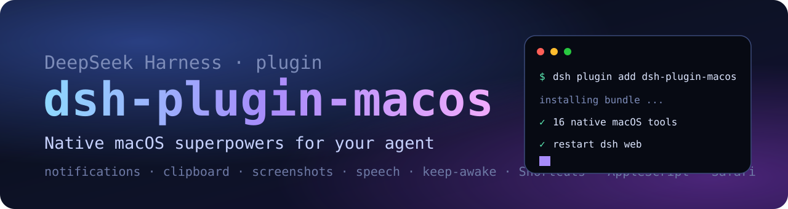

<p align="center">
  
</p>

<h1 align="center">dsh-plugin-macos</h1>

<p align="center">
  <b>给你的 DeepSeek Harness 智能体一双操作 Mac 的手。</b><br>
  21 个本地工具：通知、剪贴板、截屏、朗读、防休眠、深色模式、Spotlight、快捷指令、AppleScript 与 Safari 控制。
</p>

<p align="center">
  <a href="LICENSE"></a>
  
  
  
</p>

<p align="center"><a href="README.md">English</a> | 中文</p>

---

**智能体会写代码，这个插件让它能直接动手操作你的 Mac。**

DeepSeek Harness（dsh）的智能体本来就能跑 bash，但每个 macOS 原生动作都要手写 AppleScript。
``dsh-plugin-macos`` 把 21 个高频 Mac 操作封装成模型可调用的工具：通知、剪贴板、截屏、朗读、防休眠、
外观、Spotlight、快捷指令、AppleScript，以及真正在用的 Safari 标签页。所有操作都通过
``child_process`` 和 ``osascript`` 在本地完成：不连接云端、不装浏览器扩展、不依赖辅助功能树、无需构建、
零 npm 依赖。

## 为什么做这个插件

- **覆盖面广**：覆盖日常 Mac 琐事的长尾，而不是只做一个狭窄的小技巧。
- **从结构上保证安全**：所有命令都使用 argv 数组，绝不拼接 shell 字符串，页面文本、文件名和模型输出
  都无法注入命令；也不提供删除、关机、提权这类危险动作。
- **零依赖、纯 ESM**：``git clone`` 后添加 bundle、重启即可，不需要编译或执行安装脚本。
- **中英双语**：文档、插件元信息和工具描述都提供中英文。
- **权限透明**：读写拆成独立工具，每个需要授权的地方都在下方写明。

## 工具（21 个）

### 系统

| 工具 | 功能 | 说明 |
|---|---|---|
| ``macos_info`` | 系统版本、芯片、主机名、运行时长、电池、磁盘、内存 | 只读 |
| ``macos_network`` | 主机名、主网卡、IPv4、当前 Wi-Fi 名称 | 只读 |
| ``macos_processes`` | 按 CPU 或内存排序的进程占用榜 | 只读 |
| ``macos_spotlight`` | 用 Spotlight（``mdfind``）搜索文件 | 只读 |
| ``macos_finder_path`` | 取前台 Finder 窗口的 POSIX 路径 | 只读 |
| ``macos_frontmost_app`` | 当前最前台的应用名 | 只读 |
| ``macos_screenshot`` | 截取全屏或指定区域为 PNG，返回文件路径 | 屏幕录制权限 |

### 日常操作

| 工具 | 功能 | 说明 |
|---|---|---|
| ``macos_notify`` | 系统通知横幅，可选提示音 | 自动化权限 |
| ``macos_say`` | 用系统语音朗读文本 | |
| ``macos_clipboard_read`` | 读取剪贴板文本 | 只读 |
| ``macos_clipboard_write`` | 写入剪贴板文本 | |
| ``macos_volume`` | 读取或设置音量 0–100 | |
| ``macos_dark_mode`` | 读取或切换深色模式 | 自动化：System Events |
| ``macos_keep_awake`` | 用 ``caffeinate`` 防止 Mac 与屏幕休眠，可停止、可查询状态 | |
| ``macos_shortcuts`` | 列出快捷指令，或按名称运行某个快捷指令 | |
| ``macos_open`` | 打开网址、文件、文件夹或应用 | |
| ``macos_applescript`` | 运行 AppleScript 或 JXA 并返回 stdout | 能力很强 |

### Safari

| 工具 | 功能 | 说明 |
|---|---|---|
| ``safari_tabs`` | 列出所有 Safari 窗口与标签页，以及当前活动标签 | 自动化：Safari |
| ``safari_open`` | 在新标签页或当前标签页打开网址 | |
| ``safari_page_text`` | 读取前台页面的可见文本 | |
| ``safari_javascript`` | 在前台标签页执行 JavaScript 并返回结果 | 需要开启一个 Safari 设置 |

> Safari 工具直接操作**你正在使用、已登录的 Safari**——不需要浏览器扩展，不需要云端浏览器，不需要 API Key。

## 安装

**环境要求：** macOS 13 或更高版本、DeepSeek Harness 0.2.x，以及 dsh 自带的 Node 运行时。

### 从本地 checkout 安装（推荐）

```sh
git clone https://github.com/wu04186767/dsh-plugin-macos.git
dsh plugin --profile web add ./dsh-plugin-macos
```

如果你用的是 DeepSeek Harness 桌面版，请把 ``web`` 换成 ``desktop``，然后重启应用（或重启 dsh）让 bundle 生效。

### 直接从 GitHub 安装

```sh
dsh plugin --profile web add github:wu04186767/dsh-plugin-macos
```

### 验证

```sh
dsh --profile web --dump-config | grep dsh-plugin-macos
```

在组合后的 profile 中能看到该插件行，Web UI 的 **设置 → 插件** 中也会出现它。然后对智能体说：

> 用 macos_info 工具看看我的磁盘还剩多少空间。

## 权限

部分工具第一次调用时，macOS 会弹出一次授权提示。请允许承载 dsh 的应用（DeepSeek Harness，
或你启动 dsh 的终端）进行相应操作：

| 权限 | 涉及工具 | 授权 / 撤销位置 |
|---|---|---|
| 自动化 → Safari | ``safari_*`` 系列 | 系统设置 → 隐私与安全性 → 自动化 |
| 自动化 → System Events | ``macos_dark_mode``、``macos_frontmost_app`` | 同上 |
| 自动化 → Finder | ``macos_finder_path`` | 同上 |
| 屏幕录制 | ``macos_screenshot`` | 系统设置 → 隐私与安全性 → 屏幕录制 |
| Safari 开发者设置 | ``safari_javascript`` | Safari → 设置 → 开发者 → 允许来自 Apple 事件的 JavaScript |

插件**不发起任何网络请求**，**不收集任何遥测数据**。

## 使用示例

- "构建完成后发系统通知，再朗读一句 done。"
- "读一下我现在看的这个 Safari 标签页，帮我总结。"
- "开始防休眠，跑 40 分钟测试，结束后停止。"
- "截个屏，告诉我屏幕上有什么。"（需要模型具备视觉能力）
- "在我 Mac 上搜一下 Q3-report.pdf，把路径给我。"
- "切到深色模式，音量调到 20。"
- "运行我那个叫「开始专注」的快捷指令。"

## 安全说明

这些工具以加载插件的 dsh 进程的权限操作你的 Mac，和内置 ``bash`` 工具是同一级别的信任。几点建议：

- 批准工具调用前，先看一眼智能体要做什么。
- ``macos_clipboard_read`` 可能读出你之前复制的密码或令牌。
- ``macos_applescript`` 能自动化几乎任何 Mac 应用，请把它当作任意本地自动化能力。
- 插件不提供删除文件、关机、提权之类的工具。

## 兼容性

- DeepSeek Harness 0.2.x（插件 bundle 仍处于开发者预览阶段，版本间 API 可能变化）。
- macOS 13+，开发与测试环境为 macOS 27.2（Apple Silicon）。
- 纯 ESM，无构建步骤，无运行时依赖。

## 开发

```sh
git clone https://github.com/wu04186767/dsh-plugin-macos.git
cd dsh-plugin-macos
node test/smoke.mjs   # 在本机跑一遍只读工具
```

```
index.js          工具定义（名称、描述、JSON Schema、execute）
lib/define.js     零依赖的工具定义构造器
lib/tools.js      真正的 macOS 操作（argv 数组 + osascript）
lib/exec.js       进程 / AppleScript 辅助函数与权限提示
test/smoke.mjs    注册检查 + 只读工具实测
locale/           中英文插件元信息
cordis.patch.yml  把插件插入 dsh profile 的 bundle patch
```

欢迎提交 Issue 和 PR，尤其是旧版本 macOS 的兼容性报告和新工具建议。

## License

[MIT](LICENSE) © 2026 wu04186767

<p align="center"><sub>用 DeepSeek Harness 在 Mac 上，由智能体和人类一起完成。</sub></p>
